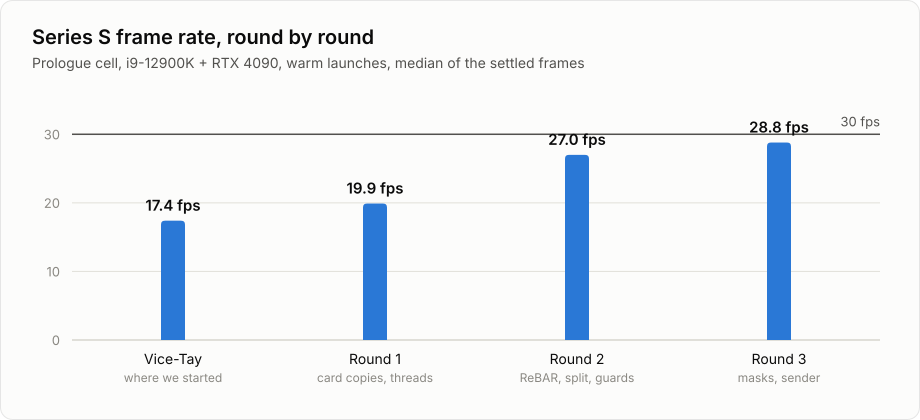
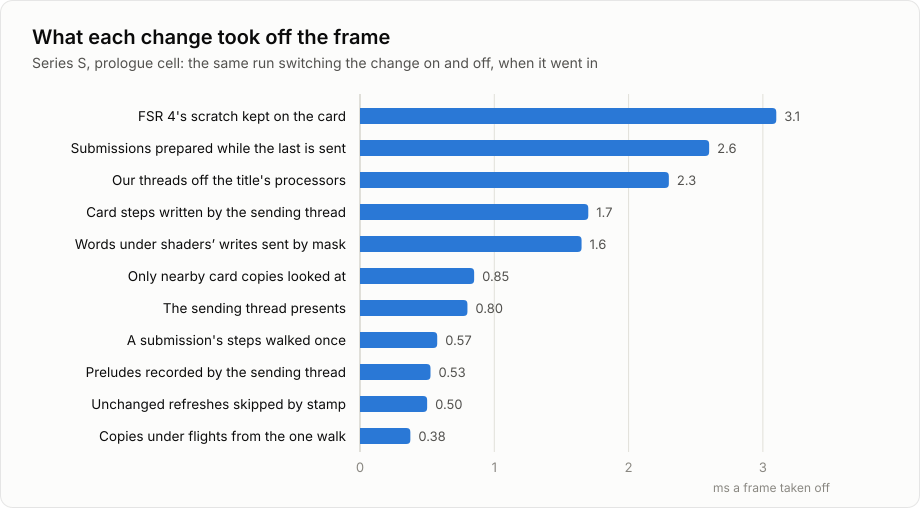
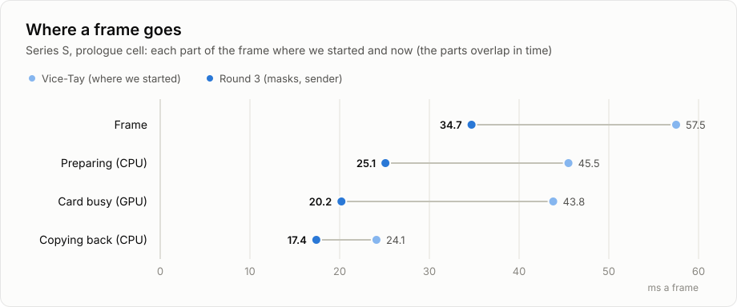
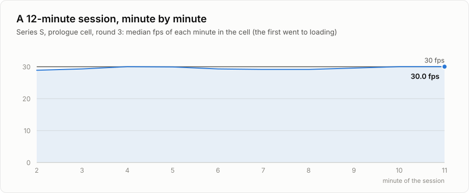

<h1 align="center">VIctory-reloaded</h1>

<p align="center">
  <b>Grand Theft Auto VI's Xbox Series build, running natively on Windows,<br>
  tuned for the Series S profile on NVIDIA.</b>
</p>

<p align="center">
  A performance fork of <a href="https://github.com/TaynanGT/Vice-Tay">Vice-Tay</a>, which carries
  <a href="https://github.com/Marvisak/VIctory">VIctory</a> and the forks credited below.
</p>

<p align="center">
  
</p>

> [!IMPORTANT]
> **No game files, code or assets are in this repository.** You need your own copy of the
> game. VIctory-reloaded is not affiliated with or endorsed by the game's developer or
> publisher. The pictures and the video here are release attachments, outside the tree
> ([asset policy](docs/asset-policy.md)).

## At a glance

| | |
|---|---|
| **Series S, prologue cell** | **28.8 fps** (34.7 ms a frame), from 17.4 fps on the Vice-Tay tree we started from |
| **Graphics card** | busy 20.2 ms of a frame, from 43.8 |
| **A 12-minute session** | 28.9-30.0 fps minute by minute; the game's memory held between 24.8 and 26.9 GB |
| **Series X, same scene** | 21.1 fps (47.4 ms a frame), from 12.4-13.7 fps where we started |
| **Loading** | to the cell about 10 s sooner: most pipelines come from the pipeline library |

Measured on an i9-12900K, an RTX 4090 and 64 GB of RAM, with `scripts\play.ps1`'s settings,
on a quiet machine, warm launches ([Measurements](#measurements)).

<picture>
  <source media="(prefers-color-scheme: dark)" srcset="docs/charts/reloaded-fps-dark.svg">
  
</picture>

## Preview

<table>
  <tr>
    <td width="50%"></td>
    <td width="50%"></td>
  </tr>
</table>

&#9654;&#65039; **[A minute of the prologue in 1080p](https://github.com/Biskwit/VIctory-reloaded/releases/download/v0.1.0-preview/reloaded-preview.mp4)**
(MP4, 17 MB): the title card, the dialogue and the cell, recorded from the game's window with
the overlay's live frame rate in the corner. The screenshots are saved by the game itself,
without the overlay.

## What we changed

Three rounds of measured changes on top of Vice-Tay. Most sit behind a switch (`=0` brings
the old path back), were measured by switching them on and off in the same run, and went in
after a gate: a cold launch on a fresh cache, three warm ones, a long session, and checks
that compare what the card and the title each hold.
[docs/optimizations.md](docs/optimizations.md) has every change with all its numbers.

**Preparing the card's work on the CPU.** This is what sets the frame now.

| Change | Switch | Measured |
|---|---|---|
| A submission is prepared while the one before it is sent, on a second thread | `VICTORY_SUBMIT_SPLIT` | −2.6 ms a frame |
| Our threads kept off the processors the title pins its own to | `VICTORY_PLACE_APART`, `VICTORY_PLACE_LANE` | −2.3 ms |
| The card steps' slot writes done by the sending thread | `VICTORY_OFF_LINE` | −1.7 ms |
| A submission looks only at the card copies it touches, not all ~3,700 | `VICTORY_CARD_NEAR` | −0.85 ms |
| The sending thread also makes the Present, behind the present's copy | `VICTORY_PRESENT_OFF_LINE` | −0.8 ms; the title waits 1.5 ms less at presents |
| A submission's steps walked once, for asking, refreshing and the copies under flights | `VICTORY_ONE_WALK`, `VICTORY_STALE_WALKED` | −0.6 and −0.4 ms |
| The lists' preludes recorded by the sending thread | `VICTORY_PRELUDE_OFF_LINE` | −0.5 ms |
| The card steps' plan made once instead of twice | `VICTORY_PLAN_ONCE` | −0.5 ms of the submitting thread |
| Fewer worker threads where the CPU has fewer than 32 | `play.ps1` (8/6/3) | about −4 ms |

**Memory the title and the card share.** The write watch, the guards and the copy back.

| Change | Switch | Measured |
|---|---|---|
| Title words under shaders' writes sent as masks, a bit a word, instead of ~100,000 runs | `VICTORY_UNDER_MASKS` | −1.65 ms |
| A refresh that nothing new came for is skipped by a stamp, with no lock | `VICTORY_REFRESH_STAMPS` | −0.5 ms; ~9,000 of 10,500 refreshes a frame |
| The write watch's journal in 4 MiB pieces instead of one tree | always on | a look at a range 111 → 20 ns |
| The title's writes into guarded memory go in beside the guard | `VICTORY_STORE_BESIDE`, `VICTORY_COPY_BESIDE` | all threads' guard-lock waits 54-60 → 32-36 ms a frame |
| A write fault on a block shown at one address opens it without the guards' lock | `VICTORY_FAULT_FAST` | those waits another −55% |
| `XMemAllocDefault` blocks of 1 MiB and more are write-watched memory | `VICTORY_XMEM_WATCHED` | a 21 MB block no longer copied whole twice a frame |

**The graphics card.**

| Change | Switch | Measured |
|---|---|---|
| Title buffers from 64 KiB up get a copy in the card's own memory | `VICTORY_CARD_BUFFERS_MIN_KB=64` | card 34.7 → 24.3 ms a frame (frame replay) |
| Windows of title memory in the card's memory, written through resizable BAR | `VICTORY_WINDOWS_BAR_MB=6144` | card busy 27-32 → 18-21 ms |
| FSR 4's 21 MB scratch stays on the card instead of being copied back | `VICTORY_LAND_NOT` | −3.1 ms a frame; landing what shaders wrote 25.2 → 18.2 ms |

**Loading and the picture.**

- Pipelines with static samplers skip the pipeline library on NVIDIA, the rest load from it:
  the cell comes about 10 s sooner (77 s against 87), with no banding or pale hair.
- Clears of unordered access views do what they say (`VICTORY_CLEAR_UAV`); the ambient
  stand-in reads the title's depth, not its stencil (`VICTORY_AMBIENT_DEPTH`); indirect
  dispatches of more than 65,535 groups run whole; compute pipelines a dispatch waits for
  are made first; pipelines with a comparison sampler stay out of the library.
- Vice-Tay's newer translator and landing fixes, merged in: among them the cell's
  volumetric passes, dropped before, are drawn.

<picture>
  <source media="(prefers-color-scheme: dark)" srcset="docs/charts/reloaded-levers-dark.svg">
  
</picture>

## Measurements

Series S profile, the prologue's cell, i9-12900K (8 fast cores, 8 slow), RTX 4090, 64 GB,
`scripts\play.ps1`'s 4090 settings, in a window. A warm-up launch first, then warm launches
of each build in turn, with no build or other launch running; medians of the game's
frame-rate lines (one every 5 s) over the first minute in the cell, once the scene has settled.

| Build | fps: median (p10) | ms a frame | preparing / card busy / copying back |
|---|---|---|---|
| Vice-Tay where we started (4fa2f0b), 2 launches | 17.4 (16.7) | 57.5 | 45.5 / 43.8 / 24.1 |
| Round 1, 3 launches | 19.9 (19.0) | 50.3 | 40.0 / 30.8 / 26.5 |
| Round 2 (0ae83d16), 3 launches | 27.0 (25.9) | 37.1 | 30.1 / 20.3 / 18.2 |
| Round 2 (0ae83d16) again, beside round 3, 3 launches | 26.3 (24.3) | 38.0 | 30.1 / 21.3 / 17.6 |
| **Round 3 (36dc2028), 3 launches** | **28.8 (26.9)** | **34.7** | **25.1 / 20.2 / 17.4** |
| Round 3, a 12-minute session | 29.6 (28.6) | 33.8 | 24.9 / 20.5 / 16.1 |

The parts overlap in time. The frame is still set by the CPU thread that prepares the
submissions; about half of any time taken off that thread reaches the frame now, and the
title's own work is part of the frame's chain since the sending thread presents.

<picture>
  <source media="(prefers-color-scheme: dark)" srcset="docs/charts/reloaded-frame-parts-dark.svg">
  
</picture>

<picture>
  <source media="(prefers-color-scheme: dark)" srcset="docs/charts/reloaded-session-dark.svg">
  
</picture>

Series X, the same scene and settings, 2 warm launches of round 3: 21.1 fps (p10 18.8),
47.4 ms a frame; preparing 25.5, card busy 33.3, copying back 29.4 ms. Where we started it
ran at 12.4-13.7 fps (73.0-80.7 ms a frame).

## Getting started

You need Windows 10 or 11 x64, a CPU with AVX2, a Direct3D 12 GPU with shader model 6.6 and
mesh shaders, Rust (the toolchain is pinned in the repository), the MSVC build tools with a
Windows SDK, and your own dump of the game.

```powershell
git clone https://github.com/Biskwit/VIctory-reloaded
cd VIctory-reloaded
copy victory.example.toml victory.toml      # then set your paths, outside this folder
cargo build --locked --profile diag -p victory --features diagnostics
```

Before the first run, translate the shaders and warm the pipelines (each can be stopped and
resumed):

```powershell
target\diag\victory.exe shaders <the shader archives>   # every shader, takes minutes
target\diag\victory.exe warm --used                     # pipelines earlier runs drew with
```

Then play, on the Series S profile:

```powershell
scripts\play.ps1 -Exe <path of your copy's executable> -Console series-s
```

`Play-VIctory.cmd -Exe <path>` does the same from a double-click or a Command Prompt.

For titles that use BCPack, set `VICTORY_BCPACK_TABLES` to the path of a local copy of the
[format tables](docs/asset-policy.md#bcpack) you are authorised to use.

| Option | What it does |
|---|---|
| (none) | Full screen, Series X profile, settings picked for your graphics card |
| `-Console series-s` | Run as a Series S: a smaller picture, lighter on the card, faster |
| **F11** or **Alt+Enter** | Switch between full screen and a window while it runs |
| `-Windowed` | Start in a window |
| `-Machine 4090` / `7900xtx` | Force the settings for NVIDIA (measured on the RTX 4090) or AMD |
| `-Safe` | Leave out the changes still on trial; try it first when something goes wrong |
| `-RayTracing` | Turn the title's ray-traced indirect light on |
| `-Build release` | Run `target\release\victory.exe` (`cargo build --release --locked -p victory`) |

Every `VICTORY_...` switch is described in a comment where the code reads it.

## The overlay

On in every build (`VICTORY_OVERLAY=0` hides it): a compact table at the top left of the
window, drawn just before the picture is presented, so saved frames and shots never show it.

| Row | What it shows |
|---|---|
| fps, ms | frames a second and time a frame over the last second: green from 15 fps, amber from 10, red below |
| CPU prep | preparing the card's work on the CPU, a frame, with a bar of its share of the frame |
| GPU busy | the frame's time less the time the card had nothing of ours queued |
| Copy-back | comparing and copying what shaders wrote back into title memory |
| Draws, Dropped | draws a frame, and those dropped while their pipeline is being made |
| VRAM | the card's memory in use, of the system's budget for the game |

A diagnostics build adds dispatches, shaders and pipelines made or loaded, shared memory,
dynamic descriptor slots and the live switches. Vice-Tay's own panel (`VICTORY_PANEL=1`,
**F3**) is drawn over it when shown.

## Diagnostics builds

`cargo build --locked --profile diag -p victory --features diagnostics` builds
`target\diag\victory.exe` with the tools below; Vice-Tay's (frame capture, dumps, frame
record and [replay](docs/replay.md)) are in [docs/README-fxceless.md](docs/README-fxceless.md).

| Variable | Effect |
|---|---|
| `VICTORY_CONTROL=<file>` | the control file (default `D:\victory-control.txt`), below |
| `VICTORY_AB=<seconds>,<SWITCH>,...` | switches those switches on and off every so many seconds in one run, and logs each phase: the A/B most changes above were measured with |
| `VICTORY_PIX=1` | loads PIX's GPU capturer at the start, for the control file's `pix` |
| `VICTORY_PIX_CAPTURE=<frame>:<file.wpix>` | PIX captures that frame into the file |

At each present the control file is read; when it changed, its commands run once and the
file is deleted:

| Command | Effect |
|---|---|
| `overlay on` / `overlay off` | shows or hides the overlay |
| `view <n> [r\|g\|b\|a\|rgb]` / `view <0xaddress>` / `view off` | presents the frame's `n`-th target, or a texture by address, instead of the frame |
| `targets` / `dump` | logs the next frame's targets / saves them |
| `shot [name]` | saves what the window shows, at full size, without the overlay |
| `pix <file.wpix>` | PIX captures the next frame |
| `set NAME=VALUE` / `unset NAME` | changes a live switch for the rest of the run |
| `repair textures` / `repair aliases` / `repair heaps` | uploads, copies or compares again what may have gone stale |

## Known problems

- **A dark, stepped shape on the cell's left wall** in about 6% of launches, and once in a
  while a dark interior instead; either holds for the whole launch and does not carry over
  to the next one. The cause is not found.
- **Below 30 fps on Series X**, and all our numbers are from the prologue's cell: the open
  world is measured in [Vice-Tay's README](https://github.com/TaynanGT/Vice-Tay#readme).
- **Long sessions.** The game's memory does not grow over our 10-12 minute sessions;
  Vice-Tay measured it growing over an hour in new areas, which we have not measured here.
- **Ray tracing.** The ray-traced structures are not built by default (`-RayTracing` turns
  the builder on), so a few hundred dispatches a frame are skipped and some light is missing.
- **The first launch of a new build** translates every shader while it plays: translate
  them ahead (above).

## Credits

This is other people's work with a little more on top. The history is kept, and commits
taken from elsewhere name the original commit and its author;
[docs/credits.md](docs/credits.md) lists everyone with a commit.

- **[Vice-Tay](https://github.com/TaynanGT/Vice-Tay)** by TaynanGT: the tree this one is
  built on, with its own work and that of everyone below.
- **[VIctory](https://github.com/Marvisak/VIctory)** by Marvisak and its contributors: the
  loader, the runtime services, the Direct3D 12 back end and the shader recompiler.
- **[avatarmanz/VIctory-7900XTX](https://github.com/avatarmanz/VIctory-7900XTX)**: list calls
  recorded on the title's threads and translated by workers, submissions prepared on
  threads of their own, cheaper write guards, textures on a copy queue, frame record and
  replay.
- **codec-d/cool_fox** (taken down by its author): two-plane composition, fallback heaps,
  table plans, the residency guard, fence wakes on `WaitOnAddress`, wave32 lowering for
  NVIDIA, movie-plane uploads and XMA audio fixes.
- **[DexNom/VIctory](https://github.com/DexNom/VIctory)**: ray tracing fixes, cube
  gradients, sparse textures.
- **[Belobug/VIctory-Belobug-AMD](https://github.com/Belobug/VIctory-Belobug-AMD)**: the
  ambient light idea, pipeline workers, and work by romainhedouin.
- **[FQY55kai/ZJOU-VICTORY](https://github.com/FQY55kai/ZJOU-VICTORY)**.
- **[myokex/victory-amd](https://github.com/myokex/victory-amd)**: the guard over every view
  of a page (with Spexivus, joroyt and tightfall), and Joshua Odom's reads into title memory.
- **Geckomacabre** and **cxy0072019-sketch**: the texture read-back.
- **[fxceless/victory-fork](https://github.com/fxceless/victory-fork)** and the people whose
  pull requests it carries: the tree our earlier work started from.
- **[XCL](https://github.com/ivall/xcl)** (GPL-2.0-only) was read for how the same title
  behaves under another layer; no code of it is here.
- **VIctory-reloaded** (Biskwit): the changes above, the overlay, the control file and live
  switches, the texture view and shots, PIX captures from the run, and the earlier tree's
  fixes and tools.

## License

GPL-3.0-or-later, as VIctory and Vice-Tay. See [LICENSE](LICENSE); the one file it does not
cover is named in [docs/asset-policy.md](docs/asset-policy.md).
