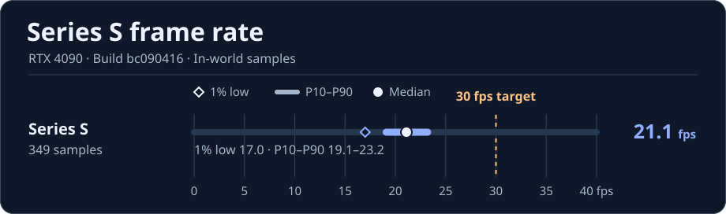
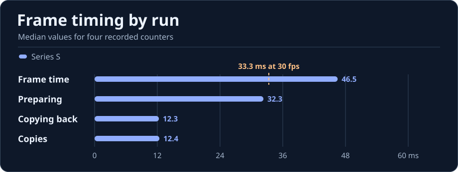

# VIctory-reloaded

VIctory-reloaded runs the Xbox Series build of Grand Theft Auto VI natively on
Windows, from files you supply. It is [Vice-Tay](https://github.com/TaynanGT/Vice-Tay)
by TaynanGT, which carries [VIctory](https://github.com/Marvisak/VIctory) and
the work of the forks credited below, with a thin layer of ours on top: an
on-screen overlay in every build, and tools for looking into a running game in
diagnostics builds. Vice-Tay's main branch is merged in as it moves.

**No game files, code or assets are in this repository.** You need your own
copy of the game. VIctory-reloaded is not affiliated with or endorsed by the
game's developer or publisher.


*The prologue's first gameplay shot on an RTX 4090. The picture is a release
attachment, outside the repository: by the [asset policy](docs/asset-policy.md)
nothing from the game goes in the tree.*

## What this tree is

- **Vice-Tay's tree, whole.** Its status, measurements, known problems, set-up
  and `scripts\play.ps1` apply here as they are: they are in Vice-Tay's README
  below the line, and its `docs` folder is unchanged.
- **Our layer**, a few commits on top, each naming the commits of our earlier
  tree it comes from:
  - the overlay (below), in every build;
  - pipelines with a static comparison sampler kept out of the pipeline
    library, as our earlier tree did: the driver's stored copies sample
    without the comparison (`VICTORY_LIBRARY_COMPARISON=1` stores them as
    before);
  - on NVIDIA only pipelines with static samplers skip the pipeline library
    (Vice-Tay fa8fc1d4): warm launches that loaded every pipeline from it
    drew the flat bands of colour listed below in 5 of 6 launches, and the
    driver's stored copies of static-sampler pipelines were what went wrong.
    Loading the others (about 950 of 1,800 in the cell) showed no banding
    and no pale hair in 6 warm Series S launches and 3 warm Series X ones;
    the cell comes about 10 s sooner (77 s median against 87), and frames
    are as before, as the static-sampler half is still made every launch.
    `VICTORY_LIBRARY_LOAD=0` loads none, `1` all, `samplers` this rule;
  - the write watch's asked ranges are a sorted index instead of a list
    walked at each look, and a submission's asking holds only its own
    pages: a few tenths of a millisecond to a millisecond on the submitting
    thread, not visible in the frame;
  - translated shaders carry a real shader hash part instead of zeros;
  - indirect dispatches of more than 65,535 groups run whole on NVIDIA too,
    as they did on AMD only: cut, the Series X cell scene showed rows of
    blocks at its bottom right (`VICTORY_INDIRECT_WIDE=0` cuts them). The
    dark stepped shape on the left wall and the speckles on the bunk that
    some launches show in that scene are not theirs: they come and go by
    launch with the cut too, and the shape shows on Series S with Vice-Tay's
    own tree and no ambient stand-in;
  - compute pipelines a dispatch asks for made first, and waited for within
    a cap, instead of dropped behind the draws' (`VICTORY_COMPUTE_FIRST=0`,
    `VICTORY_COMPUTE_WAIT`): cold launches kept the main character's head;
  - clears of unordered access views (`ClearUnorderedAccessViewUint` and
    `...Float`) are list methods; a clear did nothing before. The title
    clears two things that way, once, when the world begins: FSR4's 21 MB
    scratch block and an 80x45 texture with a value per 16x16 tile of the
    picture. What they held instead is read: with bytes 0xff in them every
    frame is white (`VICTORY_CLEAR_UAV=0`: left out, as before;
    `=poison[:<byte>[:buffer|:texture]]`: that byte instead, diagnostics).
    Still open: in about 7% of launches the cell comes up with a dark,
    stepped shape on its left wall (8 of 123 launches without the clears,
    0 of 11 with them), and once in those 11 the whole interior was dark
    instead; either state holds for the whole launch. What the title clears
    is read at least once at the world's start (bytes 0xff in the tile
    texture alone leave the picture white), but which pass reads it and
    what keeps the per-launch state is not found;
  - the control file, live switches, the texture view and window shots
    (diagnostics builds);
  - PIX captures taken from inside the run (diagnostics builds);
  - Series S speed on a PC with an i9-12900K (24 logical processors: 8 fast
    cores of two threads, 8 slow ones) and the RTX 4090, measured in the
    prologue's cell with frame replays and launches (table below):
    - title buffers from 64 KiB up get a copy in the card's own memory, not
      from 1 MiB (`VICTORY_CARD_BUFFERS_MIN_KB=64` in `play.ps1`'s 4090
      block): in the PC's memory every load a shader makes of them crosses
      the bus. A frame replay spent 34.7 ms on the card, 24.3 with them on it;
      live (on a trial merge of Vice-Tay's newer main) the card was busy 17 ms
      less a frame, for 0.4 GB of its memory;
    - fewer worker threads where the processor has fewer than 32 logical
      ones (8/6/3 list, under-write and landing threads instead of 12/8/6):
      more of them than the fast cores run made the submitting thread, which
      a frame waits for, share its core; 58.0-60.4 -> 54.3-56.1 ms a frame on
      that trial merge;
    - `XMemAllocDefault` blocks of 1 MiB and more are write-watched memory of
      their own, not the host heap's (`VICTORY_XMEM_WATCHED=0`: as before): a
      21 MB block that shaders write was copied whole twice a frame (42 MB,
      4.4 ms on the frame's path) and sent up to the card as often;
    - the frame replay makes the buffers of heaps opened from memory and of
      heaps made not resident (it lost the card on this capture), and with
      `--breadcrumbs` names the list, breadcrumb and resource a lost card
      stopped at;
    - windows of title memory in the card's memory, written by the CPU
      through resizable BAR (Vice-Tay bd68f5e's `VICTORY_WINDOWS_BAR_MB`, at
      most 6 GB in `play.ps1`'s 4090 block; a card with a budget under 20 GiB
      or without resizable BAR keeps them in the PC's memory): the card was
      busy 27-32 ms a frame, 18-21 with them, for about 5 GB more of its
      memory. Measured in the cell only; a large outdoor scene is untested;
    - what FSR4's passes write to their scratch, one 21 MB block every frame,
      stays on the card (`VICTORY_LAND_NOT`, their 20 programs listed in
      `play.ps1`): the title's CPU never reads it (a diagnostics probe,
      `VICTORY_LAND_NOT_PROBE=1`, saw no access over a launch), and it was a
      third of what the relay fetched and merged into title memory. One launch
      switching it on and off: 52.8 -> 49.7 ms a frame, landing 25.2 -> 18.2;
    - the title's writes into guarded memory go in beside the guard
      (`VICTORY_STORE_BESIDE`, `VICTORY_COPY_BESIDE`, both existing switches,
      now on in `play.ps1`'s 4090 block): write faults that open a block
      fell from about 300 to 200 a frame, and all threads' waits for the
      guards' lock from 54-60 to 32-36 ms a frame, most of it the title's own
      threads'. The frame does not move yet: the submitting thread is the
      wall. Diagnostics builds name where that lock is held longest;
    - a write fault on a block whose page is shown at one address only opens
      it under a gate of its own, not the guards' lock
      (`VICTORY_FAULT_FAST=0`: the lock, as before): about 72% of the faults
      that open a block take that path, and all threads' waits for the lock
      fell another 55% (28-40 -> 12-18 ms a frame). Two races in it that could
      leave a write unreported were found by a stress test and fixed; each
      has a test that holds the opener at the racy point (20 of 20 failed
      without the fix, 0 of 20 with it);
    - a guard-page fault inside one of our own copies re-arms the page
      (Vice-Tay fa116500 + c2775339): it used to leave the title's guard page
      (a thread's stack, for one) without its guard, which upstream traced to
      silent exits a few minutes into the world;
    - from Vice-Tay's newer main, translator and landing fixes: the console
      wave64 programs `play.ps1` listed are translated in the wave-wide form
      on a 32-lane card (538bf963, 37e9f348, 0367bf95). Before, nothing read
      that list and two of them, the cell's volumetric transmission passes,
      were dropped every frame; drawn, they change nothing measurable in the
      cell, and their picture elsewhere is not checked yet. Also typed
      stores keep their integer bits (189 programs change), four tiled
      shadow programs take the exact form instead of an approximate one,
      one interpolation mode per signature row (a fire program now
      validates), a level query without an array slice, the relabelled
      wave's group info, the card-copy compare in a call of its own, and the
      first piece of a parallel compare kept (6f179dd1, b4c3ceb2, 4fd34fdd,
      0dc5d1be, 41d3184e, 53c9ab5d, fa8fc1d4, 21ec8110);
    - our threads kept off the processors the title pins its own to (an HLE
      SetThreadGroupAffinity learns its masks; here it takes logical
      processors 0-13): the eight list threads go to the slow cores it
      leaves, the submitting thread to the fast ones it leaves
      (`VICTORY_PLACE_APART=0`, `VICTORY_PLACE_LANE=0`: as before). In-run
      2x2 over 3 launches: 42.3 -> 40.0 ms a frame with both; putting every
      pool on the slow cores instead cost 5 ms, as threads the submitting
      one waits for slowed down. Its gate ran at 38.3-41.9 ms a minute (about
      25 fps). Also from Vice-Tay: a batch wakes only the helpers it can use
      (d60fc84f), and the frame meter's 5-second lines run on a thread of
      their own (f36a0fcf), about 30 ms every 5 s off the submitting thread;
    - the ambient stand-in reads the title's depth: where it looked for depth
      the title binds the stencil plane of its depth texture, so its creases
      and depth-weighted interpolation worked from stencil bits. It now finds
      the depth plane among the program's views (`VICTORY_AMBIENT_DEPTH=0`:
      the old view), and binds depth only, no longer an image's UAV in an SRV
      table (Vice-Tay fa8fc1d4). In-run A/B: the cell's wall, the whole frame
      and the papers' colour each move slightly toward the reference, at the
      same frame time;
    - more of Vice-Tay's newer fixes: a new texture waits for the lists sent
      before it (`VICTORY_SHOW_NEW_LATER`, 4cd2d133, 91018a5d; upstream
      traced six device losses to this), a decoration bake's texture pass is
      known per heap (7eef1436), dynamic slots go back to their own heap
      (3fe48113, 5307ba7d), an upload no longer stops an alias copy
      (7993c1bc), and a full texture-change queue keeps its ranges
      (53a1f162);
    - the write watch's journal keeps its pages in 4 MiB pieces instead of
      one tree: a look at a range, some 10,000 a frame, takes 20 ns instead
      of 111; the submitting thread about 1 ms less a frame;
    - a submission is prepared while the one before it is sent: the line's
      thread prepares and publishes it, a second thread (victory-send)
      records the card-copy lists, waits for the heaps' records and sends
      (`VICTORY_SUBMIT_SPLIT=0`: one thread, as before). In-run A/B over 4
      launches: 53.1 -> 50.5 ms a frame, the title's wait at presents 19.9 ->
      16.0 ms; its gate ran at 43.3-46.0 ms a frame (23 fps over a 15-minute
      session).
- **Not brought over (yet)** from our earlier tree (fxceless's fork with about
  140 commits of ours): its FidelityFX SDK path for the Series S upscale
  (Vice-Tay translates FSR 4's own code) and its other rendering fixes, which
  are being checked one by one against Vice-Tay's picture. Nor its
  `victory replay-dispatch` (one compute dispatch captured and run again with
  other compiles, the pipeline library's stored binary, other samplers): it
  reaches into the translator, the pipeline library and the recording paths
  Vice-Tay changes most, its module name is taken by Vice-Tay's frame replay,
  and Vice-Tay's `victory replay` ([docs/replay.md](docs/replay.md)) already
  re-translates, swaps and skips shaders and finds what draws a pixel.

### Series S on our PC

i9-12900K, RTX 4090, 64 GB, `scripts\play.ps1` (its 4090 block), the
prologue's cell, warm launches; medians of the log's frame lines once the
scene has settled (frames 1300-3600). Vice-Tay's own measurements, on its
Ryzen 9 9950X3D, are below the line.

| Build | fps: median (p10) | ms a frame | preparing / card busy / copying back |
|---|---|---|---|
| before (4fa2f0b), 2 launches | 17.4 (16.7) | 57.5 | 45.5 / 43.8 / 24.1 |
| after (the three changes above), 3 launches | 19.9 (19.0) | 50.3 | 40.0 / 30.8 / 26.5 |
| after, the gate: 1 cold launch on a fresh cache and 3 warm ones | 19.8 (18.8) | 50.5 | 40.7 / 31.0 / 25.8 |
| after, the gate's 15-minute warm session | 20.9 (19.9) | 47.8 | 37.9 / 29.6 / 21.5 |

The same settings on Series X, in the same cell: 73.0-80.7 ms a frame before
(12.4-13.7 fps, 2 launches of 7d190fe), 57.6 ms after (17.4 fps, 1 launch);
card busy 65-70 -> 47 ms.

## The overlay

On in every build; `VICTORY_OVERLAY=0` hides it. A compact table at the top left
of the window, in Consolas (our own small font where Windows has none), drawn
over the window's picture just before it is presented: saved frames, shots and
the frame recorder never show it.

| Row | What it shows |
|---|---|
| VIctory-reloaded | and the console the title runs as (Series X or Series S) |
| fps, ms | frames a second and time a frame over the last second: green from 15 fps, amber from 10, red below |
| CPU prep | preparing the card's work on the CPU (title memory copies, texture refreshes), a frame, with a bar of its share of the frame |
| GPU busy | the frame's time less the time the card had nothing of ours queued (the card's clock of the frame line); the card's work, at most |
| Copy-back | comparing and copying what shaders wrote back into title memory |
| Draws, Dropped | draws a frame, and those dropped for want of a host pipeline (one being made) |
| VRAM | the card's memory in use, of the system's budget for the game |

A diagnostics build adds a smaller block: **GPU wait** (the submitting thread
standing for the card: the frame line's "on the GPU", near 0 on Series S, where
submissions are sent ahead), dispatches, shaders from the cache and translated,
pipelines loaded and made, pipelines being made, shared memory, the dynamic
descriptor slots taken a frame (and tables refused them), the live switches set
and the view's line. Vice-Tay's own panel (`VICTORY_PANEL=1`, **F3**) is
unchanged and drawn over ours when shown.

## Debugging tools (diagnostics builds)

```powershell
cargo build --locked --profile diag -p victory --features diagnostics   # target\diag\victory.exe
```

Vice-Tay's switches and tools (frame capture, dumps, the frame recorder) are
described in [docs/README-fxceless.md](docs/README-fxceless.md),
[docs/replay.md](docs/replay.md) and where the code reads each switch. Ours:

| Variable | Effect |
|---|---|
| `VICTORY_OVERLAY=0` | hides the overlay (every build) |
| `VICTORY_CONTROL=<file>` | the control file (default `D:\victory-control.txt`) |
| `VICTORY_PIX=1` | loads PIX's GPU capturer at the start, for the control file's `pix` |
| `VICTORY_PIX_CAPTURE=<frame>:<file.wpix>` | PIX captures that frame into the file |
| `VICTORY_PIX_DLL=<path>` | PIX's capturer (default: the newest under `C:\Program Files\Microsoft PIX`) |

A run with PIX's capturer never saves the pipeline library: the driver refuses
the one on disk under PIX, and the empty one would replace it.

### Steering a running game

At each of the title's presents the control file is looked at; when it changed,
its commands run once (one a line, `#` for comments) and the file is deleted.
It may be UTF-8 or the UTF-16 that Windows PowerShell's `>` writes.

| Command | Effect |
|---|---|
| `overlay on` / `overlay off` | shows or hides the overlay |
| `view <n> [r\|g\|b\|a\|rgb]` / `view <0xaddress> [...]` / `view off` | presents the frame's `n`-th target (first-use order, as `dump` numbers them) or a texture by address instead of the frame; floats and depth brought to the screen as dumps are, the range found named under the overlay |
| `targets` | logs the next frame's targets: number, address, size, format |
| `shot [name]` | saves what the window shows (a view included, the overlay not) at full size as `<name>.png` in `VICTORY_CAPTURE`, else beside the control file |
| `dump` | saves the next frame's targets, as `VICTORY_DUMP_TARGETS` does |
| `pix <file.wpix>` | PIX captures the next frame (a run started with `VICTORY_PIX=1`) |
| `set NAME=VALUE` / `unset NAME` | changes a live switch for the rest of the run: `VICTORY_HEAP_RECHECK`, `VICTORY_HEAP_SYNC`, `VICTORY_STALE_TEXTURES`, `VICTORY_TEXTURE_GUARD`, `VICTORY_SCISSOR_TEST`, `VICTORY_SKIP_PIPELINES`; other switches are read at the start |
| `repair textures` / `repair aliases` / `repair heaps` | uploads every title-filled texture again and makes every placed texture slot due / redoes every alias copy / compares every descriptor heap record with its host slot again |

## Credits

This is other people's work with a little more on top.

- **[Vice-Tay](https://github.com/TaynanGT/Vice-Tay)** by TaynanGT: the tree this
  one is, with its own work and that of everyone below.
- From Vice-Tay's credits ([docs/credits.md](docs/credits.md) lists everyone
  with a commit):
  - **[avatarmanz/VIctory-7900XTX](https://github.com/avatarmanz/VIctory-7900XTX)**:
    list calls recorded on the title's threads and translated by workers,
    submissions prepared on threads of their own, cheaper write guards, textures
    on a copy queue, frame record and replay;
  - **codec-d/cool_fox** (taken down by its author): two-plane composition,
    fallback heaps, table plans, the residency guard, fence wakes on
    `WaitOnAddress`, wave32 lowering for NVIDIA, movie-plane uploads and XMA
    audio fixes;
  - **[DexNom/VIctory](https://github.com/DexNom/VIctory)**: ray tracing fixes,
    cube gradients, sparse textures;
  - **[Belobug/VIctory-Belobug-AMD](https://github.com/Belobug/VIctory-Belobug-AMD)**:
    the ambient light idea, pipeline workers, and work by romainhedouin;
  - **[FQY55kai/ZJOU-VICTORY](https://github.com/FQY55kai/ZJOU-VICTORY)**;
  - **[myokex/victory-amd](https://github.com/myokex/victory-amd)**: the guard
    over every view of a page (with Spexivus, joroyt and tightfall), and Joshua
    Odom's reads into title memory;
  - **Geckomacabre** and **cxy0072019-sketch**: the texture read-back;
  - **[XCL](https://github.com/ivall/xcl)** (GPL-2.0-only), read for how the
    same title behaves under another layer; no code of it is here.
- **[VIctory](https://github.com/Marvisak/VIctory)** by Marvisak and its
  contributors: the loader, the runtime services, the Direct3D 12 back end and
  the shader recompiler.
- **[fxceless/victory-fork](https://github.com/fxceless/victory-fork)** and the
  people whose pull requests it carries: the tree our earlier work started from.
- **VIctory-reloaded** (Biskwit): the overlay, the control file and live
  switches, the texture view and shots, PIX captures from the run, and the
  earlier tree's fixes and tools.

## License

GPL-3.0-or-later, as VIctory and Vice-Tay. See [LICENSE](LICENSE); the one file
it does not cover is named in [docs/asset-policy.md](docs/asset-policy.md).

Below this line is Vice-Tay's README as it is.

---

# Vice-Tay

Vice-Tay runs an Xbox Series title natively on Windows, from files you supply,
through [VIctory](https://github.com/Marvisak/VIctory), a compatibility layer:
it loads the console executable, answers its system calls and translates its
GPU work to Direct3D 12. This tree is tuned and fixed on one PC, an RTX 4090
with a Ryzen 9 9950X3D and 48 GB of RAM, toward one goal: the open world at
30 frames a second, with the picture right, fully playable.

**No game files, code or assets are in this repository.** You need your own
copy of the game. Vice-Tay is not affiliated with or endorsed by the game's
developer or publisher.

> [!TIP]
> **[View the gameplay screenshots](https://github.com/TaynanGT/Vice-Tay-Screenshots#readme)**
>
> Ten in-game captures from the Series S playtest.

## At a glance

- **It plays.** A 70-minute session on the Series S profile went from the prison
  through a playable flashback, a boat, a camp, a fist fight and two shoot-outs,
  with menus, the map, checkpoints, deaths and retries, and never crashed or hung.
- **It is not fast enough yet.** The world runs at 14 fps on the Series X profile
  in a fresh session. In the 30-minute Series S boat test, median frame rate rose
  from 20.5 to **21.6 fps**. [Series S playtest](https://github.com/TaynanGT/Vice-Tay/pull/29).
- **It slows down the longer it runs.** In that 70-minute session the game's memory
  grew from 33 GB to 52 GB, past the 43 GB of RAM Windows sees, and the frame rate
  fell from about 20 to under 10. This is the next thing being worked on.

## Test PC

| Component | Configuration |
| --- | --- |
| CPU | AMD Ryzen 9 9950X3D, 16 cores and 32 threads |
| Motherboard | MSI MAG X870 TOMAHAWK WIFI (MS-7E51), revision 1.0 |
| BIOS | MSI 1.A93 |
| GPU | NVIDIA GeForce RTX 4090, 24 GB GDDR6X |
| NVIDIA driver | 621.40 |
| Integrated graphics | AMD Radeon Graphics |
| RAM | 48 GiB DDR5 (2 × 24 GiB), configured at 8,000 MT/s; 43.4 GiB visible to Windows |
| Page file | 128 GiB |
| System SSD | Samsung 990 PRO 4 TB NVMe |
| Additional SSDs | Samsung 990 PRO 2 TB NVMe and Samsung 970 PRO 1 TB NVMe |
| Monitor | Samsung Odyssey OLED G8 (G81SF), 3840 × 2160, 240 Hz |
| OS | Windows 11 Pro 26H2 x64, build 26300.10075 |

## Measurements

<!-- measurements:start -->
### Measured sessions (build 672cf831)

On the test PC above, with `scripts\play.ps1` and its RTX 4090 settings, in
full screen, each session walking, running, turning the camera and taking
captures every minute. Nothing compiled meanwhile; the screen was recorded
to video on the card's encoder throughout.

| Profile | In the world | To the start screen / to the world | fps: median (p10-p90; 1% low) | ms per frame (median) | Game memory, median / max | Card: memory max, load, power, temperature |
|---|---|---|---|---|---|---|
| Series X | 10 min, ended by the runner | 103 s / 161 s | **14.3** (13.6-14.7; 1% low 3.5) | 69.7: 35.0 GPU, 24.3 preparing, 20.0 copying back | 29.3 / 30.6 GB | 13.6 GB, 90.0%, 152.9 W, 57.0 C |
| Series S | 10 min, ended by the runner | 88 s / 127 s | **20.8** (19.2-21.8; 1% low 8.7) | 48.1: 0.2 GPU, 36.9 preparing, 15.8 copying back | 24.2 / 26.0 GB | 12.0 GB, 81.0%, 129.9 W, 48.0 C |
| Series X, `-Safe` | 10 min, ended by the runner | 87 s / 125 s | **15.4** (13.5-17.8; 1% low 3.3) | 64.7: 5.2 GPU, 37.3 preparing, 14.4 copying back | 33.4 / 34.9 GB | 17.6 GB, 97.0%, 154.4 W, 50.8 C |
| Series X, `-RayTracing` | 10 min, ended by the runner | 88 s / 133 s | **8.9** (6.8-11.4; 1% low 4.8) | 112.3: 63.0 GPU, 35.9 preparing, 14.9 copying back | 36.1 / 37.3 GB | 16.4 GB, 84.5%, 137.2 W, 50.4 C |
| Series S, 70 minutes played through the prison | 70 min, ended by the runner | 88 s / 126 s | **12.9** (8.3-20.1; 1% low 5.0) | 77.2: 0.0 GPU, 45.5 preparing, 16.1 copying back | 39.4 / 52.3 GB | 18.4 GB, 49.5%, 110.2 W, 50.1 C |

Every number is from the game's own once-a-second frame lines in the world
(over 1,000 draws a frame) and samples every 20 s; the full tables, with each
part of a frame, are in [docs/measurements.md](docs/measurements.md).
<!-- measurements:end -->

The [play log](docs/play-log.md) records the 70-minute session in detail.

### Benchmark charts

The charts cover the short benchmarks and the 70-minute Series S playtest on
an RTX 4090. [Open the interactive benchmark dashboard](https://taynangt.github.io/Vice-Tay/).





The chart below tracks the long Series S session minute by minute.
[Explore the recorded minutes](https://taynangt.github.io/Vice-Tay/#session).


<!-- Refresh the charts with node scripts/generate-benchmark-charts.mjs after editing the source tables. -->

## Known problems

- **Frame rate.** Below 30 fps in the world. Most of a frame goes to preparing the
  GPU's work on the CPU and copying data back, not to the GPU itself.
- **Memory grows without limit.** About 0.4-0.5 GB a minute in new areas; past
  physical RAM, frame preparation slows to a crawl.
- **Picture.** Skin, hair and some walls show flat bands of colour; some objects
  (tanks, tarps, plants, a skylight) glow in flat purple, pink or blue; some faces
  show scrambled colour patches and some eyes are lit white; clouds and reflections
  break into square blocks; a few shapes render as flat black.
- **Ray tracing.** The ray-traced structures are not built by default (`-RayTracing`
  turns the builder on), so a few hundred dispatches a frame are skipped and some
  light is missing.
- **Loading.** The first run of a new build translates every shader while it plays;
  translate them ahead (below).
- **Measuring.** On the Series S profile the log's GPU-time counter reads near zero;
  it is left out of conclusions until it is clear what it measures there.

## Getting started

You need Windows 10 or 11 x64, a CPU with AVX2, a Direct3D 12 GPU with shader
model 6.6 and mesh shaders, Rust (the toolchain is pinned in the repository),
the MSVC build tools with a Windows SDK, and your own dump of the title.

```powershell
git clone https://github.com/TaynanGT/Vice-Tay
cd Vice-Tay
copy victory.example.toml victory.toml      # then set your paths, outside this folder
cargo build --locked --profile diag -p victory --features diagnostics
```

Before the first run, translate the shaders and warm the pipelines (each can be
stopped and resumed):

```powershell
target\diag\victory.exe shaders <the shader archives>   # every shader, takes minutes
target\diag\victory.exe warm --used                     # pipelines earlier runs drew with
```

Then play:

```powershell
scripts\play.ps1 -Exe <path of your copy's executable>
```

`Play-VIctory.cmd -Exe <path>` does the same from a double-click or a Command Prompt.

| Option | What it does |
|---|---|
| (none) | Full screen, Series X profile, settings picked for your graphics card |
| **F11** or **Alt+Enter** | Switch between full screen and a window while it runs |
| `-Windowed` | Start in a window |
| `-Console series-s` | Run as a Series S: a smaller picture, lighter on the card, faster |
| `-Machine 4090` / `7900xtx` | Force the settings for NVIDIA (measured on the RTX 4090) or AMD |
| `-Safe` | Leave out the changes still on trial; try it first when something goes wrong |
| `-RayTracing` | Turn the title's ray-traced indirect light on |
| `-Build release` | Run `target\release\victory.exe` (`cargo build --release --locked -p victory`) |

Every `VICTORY_...` switch is described in a comment where the code reads it.
More commands and debugging switches:
[docs/README-fxceless.md](docs/README-fxceless.md) and [docs/findings.md](docs/findings.md).

## How this tree is built

Vice-Tay is published as a repository of its own, not as a GitHub fork, with the
whole history of the trees it comes from. It started from codec-d/cool_fox (now
taken down), which is [avatarmanz/VIctory-7900XTX](https://github.com/avatarmanz/VIctory-7900XTX)
with work for NVIDIA cards on top. New work from avatarmanz is merged as it lands,
and our own fixes come in through pull requests, each tested before it is merged.
What each change does: [docs/this-fork.md](docs/this-fork.md). How the layer
works: [docs/architecture.md](docs/architecture.md).

## Credits

This is other people's work with more on top. The history is kept, and commits
taken from elsewhere name the original commit and its author. Everyone with a
commit here is listed in [docs/credits.md](docs/credits.md).

- **[VIctory](https://github.com/Marvisak/VIctory)** by Marvisak and its
  contributors: the loader, the runtime services, the Direct3D 12 back end and
  the shader recompiler.
- **[fxceless/victory-fork](https://github.com/fxceless/victory-fork)** and the
  people whose pull requests it carries.
- **[avatarmanz/VIctory-7900XTX](https://github.com/avatarmanz/VIctory-7900XTX)**:
  list calls recorded on the title's threads and translated by workers,
  submissions prepared on threads of their own, cheaper write guards, textures on
  a copy queue, frame record and replay.
- **codec-d/cool_fox** (taken down by its author): two-plane composition, fallback
  heaps, table plans, the residency guard, fence wakes on `WaitOnAddress`, wave32
  lowering for NVIDIA, movie-plane uploads and XMA audio fixes.
- **[DexNom/VIctory](https://github.com/DexNom/VIctory)**: ray tracing fixes,
  cube gradients, sparse textures.
- **[Belobug/VIctory-Belobug-AMD](https://github.com/Belobug/VIctory-Belobug-AMD)**:
  the ambient light idea, pipeline workers, and work by romainhedouin.
- **[FQY55kai/ZJOU-VICTORY](https://github.com/FQY55kai/ZJOU-VICTORY)**.
- **[myokex/victory-amd](https://github.com/myokex/victory-amd)**: the guard over
  every view of a page (with Spexivus, joroyt and tightfall), and Joshua Odom's
  reads into title memory.
- **Geckomacabre** and **cxy0072019-sketch**: the texture read-back.
- **[XCL](https://github.com/ivall/xcl)** (GPL-2.0-only) was read for how the same
  title behaves under another layer; no code of it is here.

## License

GPL-3.0-or-later, as VIctory. See [LICENSE](LICENSE); the one file it does not
cover is named in [docs/asset-policy.md](docs/asset-policy.md).
